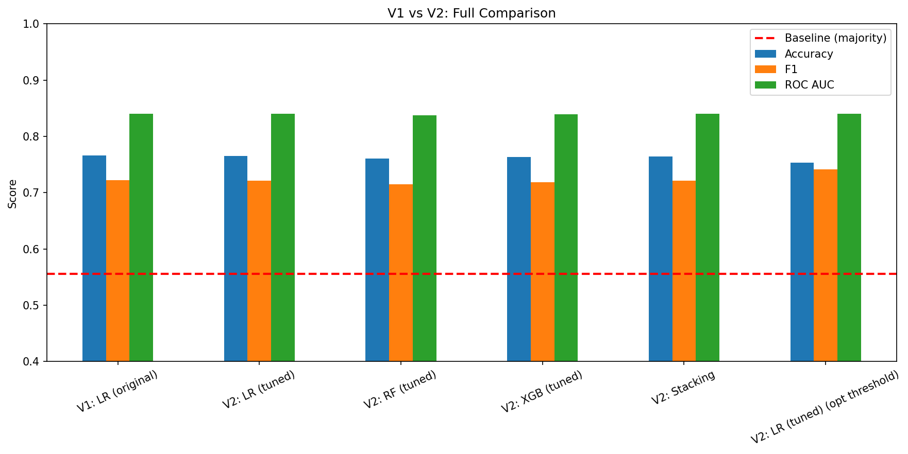

# Startup Success Prediction

A machine-learning classifier that predicts whether a startup will succeed or fail, based on its funding, team, market and traction data. It was built as a university project and covers the full workflow: exploratory analysis, feature engineering, model comparison, hyperparameter tuning, threshold optimisation and a Flask web app for live predictions.

## Results

Trained on 100,000 startups from the [Startup Funding and Outcome dataset](https://www.kaggle.com/datasets/dhrubangtalukdar/startup-funding-and-outcome-dataset) (Kaggle), using an 80/20 stratified train/test split.

| Model | Accuracy | F1 | ROC AUC |
| --- | --- | --- | --- |
| Majority-class baseline | 55.6% | – | – |
| Logistic Regression (v1) | ~76.5% | ~0.72 | ~0.84 |
| Random Forest / XGBoost / Stacking (v2, Optuna-tuned) | ~76% | ~0.72 | ~0.84 |
| Logistic Regression, tuned + optimised threshold (0.38) | ~75% | **~0.74** | ~0.84 |

**Key finding:** the tuned tree models and the stacking ensemble did not beat a well-regularised logistic regression on this dataset. The largest single gain came from tuning the decision threshold on the precision-recall curve, which raised F1 from 0.72 to 0.74.



## Approach

1. **EDA**: distributions, correlations and how each categorical feature relates to the outcome (`eda_*.png`).
2. **v1 baseline** (`startup_prediction.py`): a scikit-learn `Pipeline` with `ColumnTransformer` (scaling + one-hot encoding). It compares Logistic Regression, Random Forest and XGBoost with 5-fold stratified cross-validation.
3. **v2 improvements** (`startup_prediction_v2.py`):
   - 12 engineered features: efficiency ratios (revenue per employee, revenue to burn), interaction terms and log transforms of skewed variables.
   - Hyperparameter tuning for every model with **Optuna**, optimising ROC AUC.
   - A **stacking ensemble** with a logistic-regression meta-learner.
   - **Threshold optimisation** that maximises F1 on the precision-recall curve.
4. **Deployment**: `save_model.py` trains the final pipeline and saves it with joblib. `predict.py` runs it from the command line, and `webapp/` serves it through a Flask app.

## Tech stack

Python · pandas · NumPy · scikit-learn · XGBoost · Optuna · Matplotlib / Seaborn · joblib · Flask · PptxGenJS (presentation)

## Run it

```bash
pip install -r requirements.txt

# Train and evaluate (the dataset downloads automatically via kagglehub)
python startup_prediction.py        # v1 baseline
python startup_prediction_v2.py     # v2: feature engineering, Optuna, stacking, threshold tuning

# Predict
python predict.py                   # built-in examples
python predict.py --interactive     # enter your own startup

# Web app at http://127.0.0.1:5000
python webapp/app.py
```

A trained model (`startup_model.pkl`) is included, so `predict.py` and the web app work without retraining. Run `python save_model.py` to rebuild it.

## Repository layout

| Path | Contents |
| --- | --- |
| `startup_prediction.py` | v1: preprocessing, model comparison, test-set evaluation |
| `startup_prediction_v2.py` | v2: feature engineering, Optuna tuning, stacking, threshold optimisation |
| `save_model.py`, `predict.py` | Train and save the final model; command-line predictions |
| `webapp/` | Flask app with an HTML form for live predictions |
| `*.png` | EDA, ROC curves, confusion matrices and model comparison charts |
| `Startup_Prediction_Presentation.pptx`, `presentation/` | Project presentation and the script that generates it |
